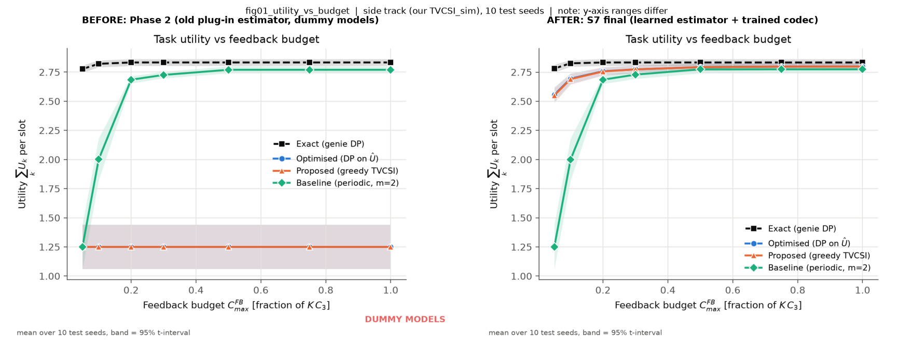
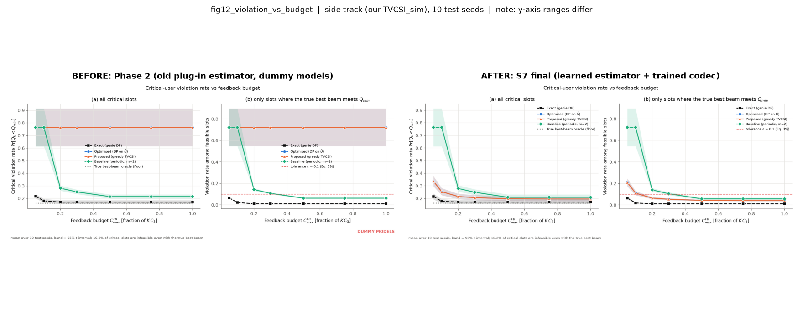
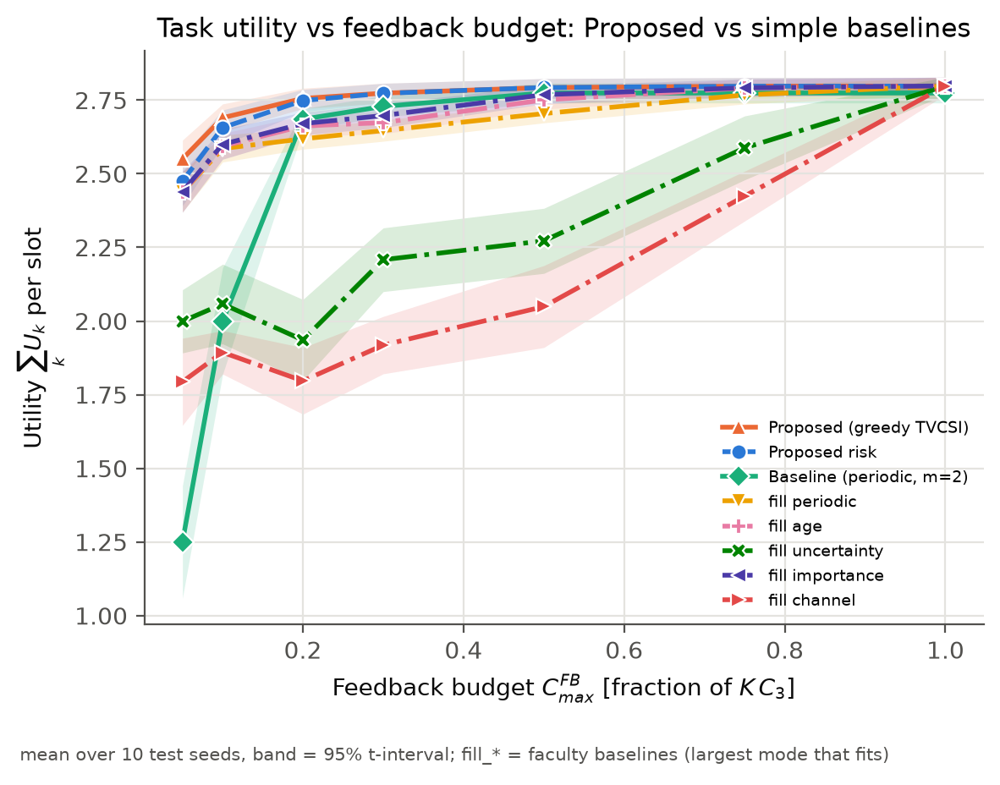
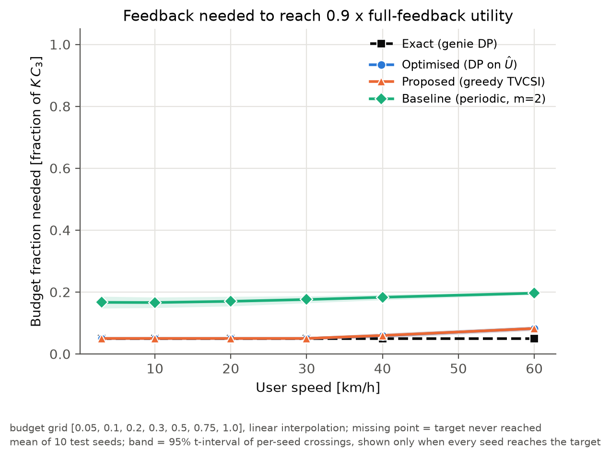

# TVCSI_sim: task-value-aware CSI feedback for a 5G NR massive-MIMO downlink

In every time slot the base station (gNB) decides **which users send channel-state feedback, and
how much**: no feedback (the beam is predicted from history), or a compressed report of
32 / 64 / 128 bits. The total feedback per slot is limited (256 bits for 8 users), so the scheduler
should spend it where it matters most: on users whose beam is likely out of date **and** whose
message is valuable. Value = importance v_k × task quality Q, where Q is the probability that the
user's message is delivered over a **measured 5G NR link** (Q = 1 − BLER).

Equation numbers in the code refer to the project specification `docs/5G_group_5.pdf`.

**Status (Nov 2026): all stages done.** The faculty review of the first version (Proposed lost to
simple baselines, 97–98 % critical violations, placeholder models, made-up quality curve) has been
addressed in Phases 1–2 and stages S0–S7. Final report: [`research/S7_final_report.md`](research/S7_final_report.md).

---

## Results at a glance

Two independent tracks were run (details in [`research/HANDOFF.md`](research/HANDOFF.md)):

* **Side track: this simulator** (our TVCSI_sim + selected faculty components). **All results
  below are from this track.**
* **Main track: the faculty's TaskVoCSI_v2**, run unmodified (`research/faculty_TaskVoCSI_v2/`).
  Their method beats their five baselines by +1.5 % (digits task) and +3.9 % (sigmoid quality),
  significant on 20 seeds ([`research/S2_faculty_results.md`](research/S2_faculty_results.md)).
  It is a different simulator, so its numbers are not directly comparable with ours.

### Headline (side track, final run, 10 held-out test seeds)

1. **The original failure is fixed.** The old estimator never asked for feedback (utility 1.25,
   last place). The learned estimator (S4) lifts Proposed to **2.774**, first among all
   implementable schemes, close to the genie (2.833).
2. **It beats every simple baseline**, the periodic one and the five faculty baselines: at **28 of
   29** sweep points it is significantly better than the *best* baseline at that point (seed-paired,
   Holm-corrected; the 29th point, unlimited feedback, is a tie).
3. **Biggest gains where feedback matters most:** low SNR (+8.8 %), scarce feedback (+4.6 % at 5 %
   budget), fast users (+4.1 % at 60 km/h). At the default point the gain is modest (+1.7 % over
   periodic), because periodic feedback is already near the genie there.
4. **Far fewer feedback bits.** To reach 90 % of the full-feedback utility, Proposed needs a budget
   of 0.05–0.08 (the smallest budget tested, for speeds ≤ 30 km/h), periodic needs 0.17–0.20: at
   least **2.4–3.4× fewer bits**.
5. **Critical users are protected better.** Of the critical-user slots where success is physically
   possible, Proposed fails 5.4 % (target ≤ 10 %), periodic 10.5 %. Every critical user meets the
   10 % target in 10/10 seeds with Proposed, 1/10 with periodic. (16.2 % of critical slots cannot
   succeed even with the perfect beam; no scheme can fix those.)

### Default point (K = 8 users, 30 km/h, 15 dB, 256 bits/slot)

| Scheme | What it is | Utility | Bits/slot | Critical failures (feasible slots) |
|---|---|---|---|---|
| Exact | genie: knows the true outcome of every option (not implementable) | 2.833 | 20 | 1.1 % |
| full_feedback | everyone sends the largest report (4× over budget, reference) | 2.798 | 1024 | 4.0 % |
| **Proposed** | **greedy scheduler on the learned value estimate** | **2.774** | 256 | **5.4 %** |
| Proposed_risk | Proposed + virtual queue for critical users (S5) | 2.773 | 256 | 5.2 % |
| Baseline | periodic round robin, 64-bit reports | 2.729 | 256 | 10.5 % |
| fill_importance / fill_age / fill_periodic | faculty baselines (S5) | 2.684 / 2.674 / 2.622 | 256 | 19.4 / 15.8 / 20.7 % |
| Proposed_plugin | the old estimator (before S4) | 1.250 | 0 | 72.1 % |

Higher utility is better (maximum ≈ 2.84 = perfect beams for everyone). Full table with confidence
intervals: [`results/final_20261103/summary.md`](results/final_20261103/summary.md).

### Before → after (same simulator, same test seeds)

Utility vs feedback budget. Left: Phase 2 (old estimator); right: final. *Note: y-axis ranges differ.*



Critical-user failures vs budget (right panel of each half = only slots where success is possible;
red dashed line = 10 % target):



### Proposed vs all simple baselines



### Feedback needed for 90 % of full-feedback utility



### Where to find every result

| What | Where |
|---|---|
| Final numbers (all schemes, all sweeps) | `results/final_20261103/` (`summary.md`, `sweep_*.csv`, `default_runs.csv`, `sensitivity.md`) |
| Final figures (PNG) | `figures/final_20261103/` (list below) |
| Before / after comparisons | `figures/before_after/` (8 figures; rebuilt by `research/tools/make_before_after.py`) |
| Measured 5G quality curves | `data/q_curves.csv`, `figures/q_curves_validation.png`, `figures/calib_q.png` |
| Faculty track (main track) results | `research/faculty_TaskVoCSI_v2/results/`, analysis in `research/S2_analysis/` |
| Superseded Phase 2 results | `deprecated/phase2_results/` |

### Limitations (stated plainly)

Synthetic channels (which is likely why a trained beam predictor does not beat "reuse the last
beam"); only the feedback part of the optimisation problem is solved (every user is served);
reliability is not guaranteed at very small budgets (5–10 %); one training run per model. Details:
[`research/S7_final_report.md`](research/S7_final_report.md) §5.

---

## Quick start

Python 3.11+. Keep the virtual environment outside the repository.

```bash
python -m venv ../venvs/tvcsi
../venvs/tvcsi/Scripts/python -m pip install -e . pytest      # Linux/macOS: ../venvs/tvcsi/bin/python
../venvs/tvcsi/Scripts/python -m pytest -q                    # 73 passed, 1 skipped (74 with sionna)
```

The first test run fits the learned estimator (2–5 min, deterministic, cached in `results/estimators/`).

**Reproduce the final results** (about 40 min on 8 cores; writes to new folders if you change
`paths` in the config, see `research/logs/review_S3_S7/REVIEW.md`):

```bash
python -m tvcsi.sweep --config configs/final.yaml
python -m tvcsi.plots --config configs/final.yaml
python scripts/make_summary.py --config configs/final.yaml
python scripts/sensitivity.py --config configs/final.yaml
```

Quick checks: `python research/logs/review_S3_S7/reproduce_final.py` re-simulates two test seeds and
compares them with the committed numbers; `python research/tools/verify_faculty.py` proves the
faculty code is untouched.

Optional extras: `pip install -e .[linklevel]` (torch + Sionna) only to re-measure the quality curves
(`scripts/measure_q.py`, GPU recommended) or re-train the S6 models (`scripts/train_models.py`).

## Repository structure

```
README.md, ASSUMPTIONS.md      overview; every modelling choice and parameter (what / why / how / where)
pyproject.toml                 package `tvcsi` and its dependencies
configs/
  default.yaml                 every parameter (placeholder models; used by the tests)
  final.yaml                   default + trained models + output folders of the final run (generated)
src/tvcsi/                     the simulator
  sim.py                       slot loop, best-beam oracle, constraint metrics
  schemes.py                   all scheduling schemes (DecisionInputs = what a scheduler may see)
  estimator.py                 S4 learned per-mode quality estimator (ExtraTrees)
  tvcsi.py                     old mean-regret plug-in estimator (kept as the *_plugin ablation)
  solvers.py                   exact DP (multiple-choice knapsack), greedy, brute force
  quality.py, link.py          measured Q = 1 - BLER (Phase 2), beams, regret, SINR, utility
  channel.py, codebook.py,     channel model, DFT beams, message types and importance, config
  importance.py, config.py
  models/                      interfaces, placeholder models, trained codec + GRU (numpy inference)
  stats.py, metrics.py         paired Holm statistics, CVaR, switching, ...
  sweep.py, plots.py           parameter sweeps (parallel) and all figures
scripts/                       measure_q (5G link-level curves), fit_estimator, train_models (S6),
                               fit_tvcsi_table, make_summary, sensitivity, calibrate_q, export_dataset
data/                          measured quality curves, carrier choice, trained model weights
tests/                         pytest suite
results/
  final_20261103/              FINAL results (CSV + summary.md)
  estimators/                  learned-estimator cache reports (the .joblib files are rebuilt)
  tvcsi_table.json             plug-in regret table (used by the *_plugin ablations and tests)
figures/
  final_20261103/              FINAL figures (PNG)
  before_after/                Phase 2 vs final, side by side
  calib_q.png, q_curves_validation.png   quality-curve figures (Phase 2, still current)
research/                      staged research work S0-S7
  HANDOFF.md                   START HERE to continue the project (context, rules, guides)
  README.md                    workflow, environments, commit rules
  S7_final_report.md           final report; S2_faculty_results.md: faculty-track analysis
  checkpoints/                 one checkpoint per stage; logs/: evidence of every stage and review
  faculty_TaskVoCSI_v2/        faculty code, UNMODIFIED (main track) + its run results
  S2_analysis/, manifests/, tools/
docs/5G_group_5.pdf            project specification (equation numbers)
deprecated/                    superseded files kept for the record (see deprecated/README.md)
```

## How a slot works

For every slot, and for every scheme on the same channel and importance realisation:

1. Channel step; true beam gains; pilot estimate.
2. Importance v_k(t) of each user's message (critical / normal / background).
3. Outcomes of the feedback modes 1–3 (encode, decode, beam choice, SINR, Q), shared by all schemes.
4. Each scheme's own beam predictor gives the predicted gains and a confidence (mode 0).
5. The scheme sees only gNB-side information (`DecisionInputs`: predicted gains, confidence, age of
   the last report, last mode, message types, importance, estimated values) and picks the modes.
   A hard check enforces the feedback budget.
6. The chosen outcome is realised and logged; the predictor keeps what the gNB actually received.

A test replaces the true channel with garbage after step 3: no non-genie decision changes, so no
scheme can cheat. The **best-beam oracle** (true best beam for everyone, free) is evaluated after the
decisions; it defines which critical slots are feasible at all.

## Schemes

| Name | Definition |
|---|---|
| **Exact** | exact DP on the **true** per-mode utilities: genie upper bound, not implementable |
| **Optimised** | exact DP on the **learned** utility estimates |
| **Proposed** | greedy marginal-value upgrades on the learned estimates (≈ Optimised, ~0.1 ms per decision) |
| Proposed_risk | Proposed + virtual queue that raises the value of feedback for critical users who fail too often |
| **Baseline** | periodic round robin, fixed 64-bit mode (rule in ASSUMPTIONS.md) |
| fill_periodic, fill_age, fill_uncertainty, fill_importance, fill_channel | the five faculty baselines: order users by round robin / oldest report / least certain beam / importance / weakest link, give each the largest report that fits |
| prediction_only, importance_only, snr_threshold, full_feedback | further references (no feedback; most important first; weakest believed link first; everyone max, over budget) |
| Proposed_no_importance | ablation: importance ignored in the value estimate |
| Proposed_plugin, Optimised_plugin, Proposed_plugin_no_* | the old mean-regret plug-in estimator (before S4), kept as ablations |

## Task quality (Phase 2)

Q is the PHY abstraction used by system-level simulators: Q_type(γ) = 1 − BLER_type(γ), measured by
`scripts/measure_q.py` with Sionna's standard-compliant 5G NR PDSCH chain (TB CRC, LDPC, rate
matching, scrambling, QAM, AWGN, APP demapper, BP decoder) for each message type's payload
(1200 / 300 / 50 bytes) over the user's PRBs, with the lowest MCS whose transport block holds the
payload. 18 curves, validated against NVIDIA's tables and a finite-blocklength bound. Every value and
its source: ASSUMPTIONS.md (Phase 2, P13–P24).

## Learned estimator (S4) and trained models (S6)

* **Estimator** (`src/tvcsi/estimator.py`): an ExtraTrees regressor predicts, per user and feedback
  mode, the expected task quality and the outage probability from gNB-side features only. Trained on
  train seeds 3000–3019, tuned on validation seeds 2000–2004, reported on test seeds 1000–1009; frozen
  and reused at every sweep point.
* **Trained models** (`src/tvcsi/models/trained.py`, weights `data/models/s6_models.npz`): a 4-bit
  progressive CSI codec (adopted) and a GRU beam predictor (it ties "reuse the last beam", so
  persistence is kept). `models: trained` in the config switches them on. Training data can also be
  exported with `python scripts/export_dataset.py` (`results/dataset/`, not in git).

## Figures (`figures/final_20261103/`)

Defaults unless varied: K = 8, M = B = 32 beams, 30 km/h, 15 dB, 25 % critical users, budget 25 %,
T = 2000 slots, 10 test seeds; bands = 95 % t-intervals.

| File | Shows |
|---|---|
| fig01–fig05 | utility vs feedback budget / number of users / speed / critical share / SNR (main schemes) |
| base01–base05 | the same five sweeps: Proposed vs all eight simple baselines |
| supp01–supp05 | the same sweeps with the supplementary references and the ablations |
| fig06, fig07 | beam regret vs speed, vs budget |
| fig08 | beam switching rate vs speed |
| fig09 | utility per feedback bit vs budget |
| fig10 | feedback budget needed to reach 90 % of full-feedback utility, vs speed |
| fig11 | CVaR (worst 5 % slots) of the semantic loss vs budget |
| fig12 | critical-user violation rate vs budget: all slots, and feasible slots only |
| fig13 | distribution (CDF) of the per-slot semantic loss |
| fig14 | solver run time vs number of users |
| fig15 | objective of problem P1 (utility minus feedback, switching and risk penalties) vs budget |
| fig16 | worst critical user's violation rate vs speed and budget (10 % target) |

## Documentation map

| Question | Read |
|---|---|
| How do I continue the project? | `research/HANDOFF.md` |
| What did each stage do and find? | `research/checkpoints/S0…S7_checkpoint.md` |
| Final results and limitations | `research/S7_final_report.md` |
| Why this parameter value? | `ASSUMPTIONS.md` |
| How were the results reviewed? | `research/logs/review_S3_S7/REVIEW.md`, `research/logs/review_codex/README.md` |
